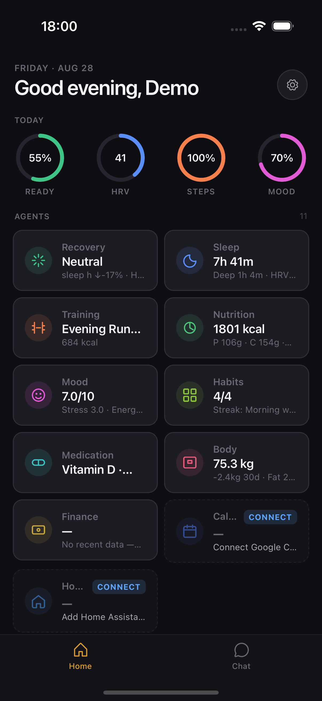
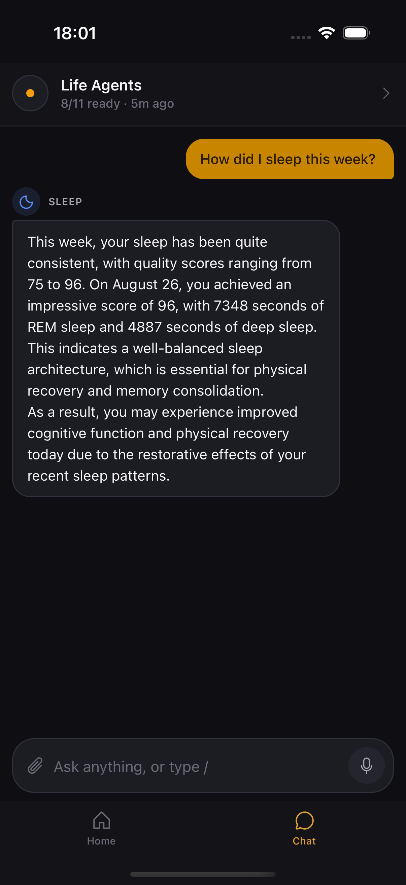
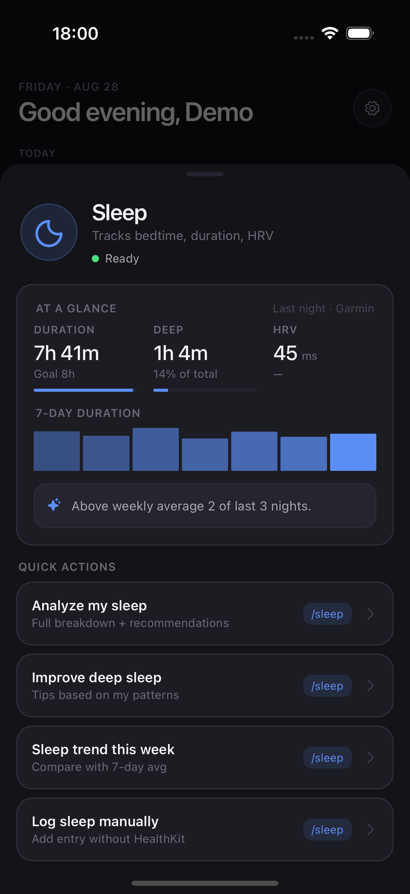
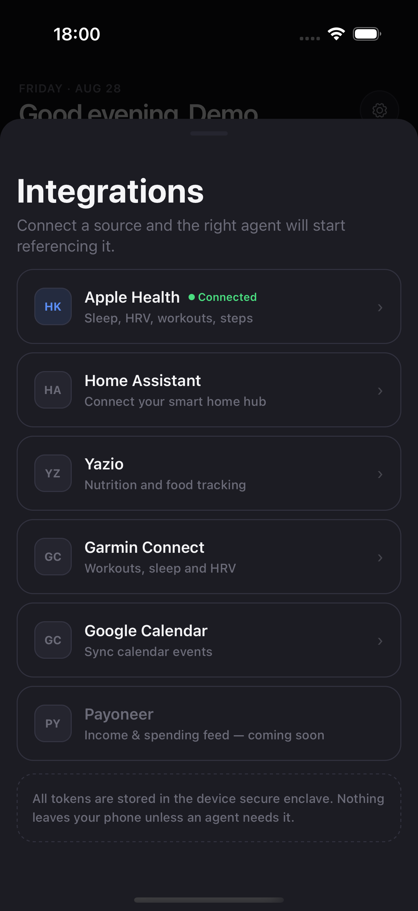
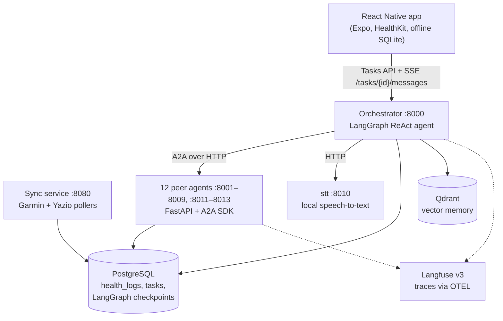

# Life Agents

A self-hosted, multi-agent health and household assistant. Twelve domain agents — sleep, workout, nutrition, body, mood, habits, recovery,
medication, kitchen, finance, calendar and home — sit behind a LangGraph orchestrator and answer questions about your own data, pulled from
Apple Health, Garmin, Yazio and Google Calendar.

Everything runs on your machine: your own Postgres, your own vector store, your
own observability stack, and the LLM provider of your choosing.

<p align="center">
  
  
  
  
</p>

<p align="center"><sub>
  Captured from the Maestro flows in <code>apps/mobile/.maestro</code>, running against
  the synthetic demo user — no real health data.
</sub></p>

## Why

Health apps each own a slice of your data and none of them talk to each other.
Garmin knows your HRV, Yazio knows your macros, Apple Health knows your steps,
and no one connects "you slept 5h20m and then ate 2 800 kcal of mostly carbs."

Life Agents puts one conversational layer over all of it. Ask _"why was my
recovery bad this week?"_ and the orchestrator consults the recovery, sleep and
workout agents, each of which reads its own domain data and reports back.

## Architecture



The orchestrator is a LangGraph ReAct agent whose conversation state is
checkpointed per server-issued task key in Postgres. Peer agents are addressed with the
[A2A protocol](https://github.com/google/A2A) — each publishes an agent card,
exposes three to four domain skills, and streams artifacts back.

### The agents

| Agent        | Port | What it owns                                         |
| ------------ | ---- | ---------------------------------------------------- |
| `sleep`      | 8001 | Sleep stages, duration, debt, bedtime consistency; foundation (ports, pipeline, RLS) |
| `workout`    | 8002 | Training sessions, load, weekly volume; foundation (ports, pipeline, RLS) |
| `nutrition`  | 8003 | Meals, macros, calorie balance                       |
| `body`       | 8004 | Weight, body composition, measurements; foundation (ports, pipeline, RLS) |
| `mood`       | 8005 | Check-ins and a coaching loop (Groq-only, zero cost); foundation (ports, pipeline, RLS) |
| `habits`     | 8006 | Habit definitions, streaks, adherence; foundation (ports, pipeline, RLS) |
| `recovery`   | 8007 | HRV, resting HR, readiness across domains; foundation (ports, pipeline, RLS) |
| `medication` | 8008 | Medication registry, doses, adherence; foundation (ports, pipeline, RLS) |
| `kitchen`    | 8009 (internal) | Household food inventory and expiry digest |
| `stt`        | 8010 (internal) | Local speech-to-text service |
| `finance`    | 8011 | Transactions, categories and Payoneer imports |
| `calendar`   | 8012 | Google Calendar events and confirmed changes |
| `home`       | 8013 | Household Home Assistant state and confirmed changes |

### Households

Every authenticated user gets a personal household on first use.
An invite code lets another user preview and join that household once.
Kitchen inventory is shared with its members; health logs and other personal data stay private.
Joining from a one-person household moves its active kitchen items into the destination household.
Household members receive the same daily expiry digest in their own notification inboxes.

The seven migrated health agents share `shared.analysis.AnalysisSkill`: load typed data
within a user-scoped unit of work, fetch selected peer context and optional memories,
compose a localized prompt, call the model, and save memory. Skill-specific data loaders
and prompt tails keep domain behavior separate. Writing skills use application use cases
and extraction schemas; all raw health-log access uses `HealthLogRepository`.

```
agents/<name>/src/<name>/
  domain/       # pure types and rules
  application/  # use cases, AnalysisData and schemas on ports
  adapters/     # SQL repositories and A2A card/executor/spec
  composition.py # dependency wiring
  main.py       # service entry point
```

`health_logs` is the universal sink for all ingested data, deduplicated on
`(user_id, source, type, recorded_at)`.

## Code structure (foundation)

New and migrated code follows a ports-and-adapters layout:

- `shared/src/shared/ports/` — typing Protocols: `LLMProvider`, `ChatModelFactory`, `Clock`,
  `Translator`, `VectorMemory`, `PeerClient`, `UnitOfWork`, `TaskRecords`, `Scheduler`,
  `SpeechToText`.
- `shared/src/shared/adapters/` — their implementations (LangChain providers with one schema
  repair, Claude Agent SDK, SQLAlchemy Unit of Work, Qdrant, A2A peers, APScheduler, JSON i18n).
- `shared/src/shared/config/` — typed settings; the only place that reads the environment.
- `shared/src/shared/schema/` — SQLAlchemy metadata and Alembic migrations.
- `shared/src/shared/a2a/` — `SkillExecutor`, the base for every migrated agent.
- `agents/nutrition/src/nutrition/` — the first migrated agent: `domain/` (pure), `application/`
  (use cases on ports), `adapters/` (SQL, HTTP, A2A card), `composition.py` (wiring).

import-linter enforces the direction of these dependencies (`make lint`). The orchestrator
and the sync service use the same layered ports and adapters.

## Database roles and row-level security

`docker compose up` runs the `migrate` service, which creates `app_owner` and `app_rw` and applies Alembic migrations (see
`deploy/postgres/README.md`). Services connect as `app_rw`: every tenant transaction sets
`app.user_id`, and PostgreSQL row-level security limits it to that user's rows.

## LLM providers

Services read `LLM__DEFAULT` and optional per-task routes `LLM__TASKS__FAST`,
`LLM__TASKS__SMART`, `LLM__TASKS__MOOD_COACH`, each `"<provider>:<model>"`. The provider
`claude_sdk` uses the Claude Agent SDK with a local Claude Code login and is meant for
personal self-hosting only. Sending a Claude subscription OAuth token to the API
(`LLM__ANTHROPIC_AUTH=oauth_token`) is an explicit compatibility option and is off by default.
Follow [Anthropic's authentication and credential-use guidance](https://code.claude.com/docs/en/legal-and-compliance#authentication-and-credential-use):
applications and services should use API keys or supported cloud credentials; do not collect or
intermediate other users' subscription credentials.

Vector memory uses `QDRANT_HOST` / `QDRANT_PORT` and `GEMINI_API_KEY`.
The typed `QDRANT_URL` field is reserved and is not consumed by that adapter. OTEL/Traceloop also retain their SDK environment configuration.
New vector writes namespace keys by user and agent; older unscoped points can coexist until
an explicit data reset or migration. Peer context is best effort with a 20-second whole-batch
deadline; a timeout discards the incomplete batch, including partial answers.

The A2A `tasks` table retains global task IDs and legacy serialization. If the SDK creates a
working task first, its initial `skill_id` and `input` remain empty under the immutable
upsert policy, although completed output/state/artifacts persist. Provider failures finish
as `failed` with a localized explanation and no success artifacts.

## Integrations

| Source          | Direction       | Notes                                                             |
| --------------- | --------------- | ----------------------------------------------------------------- |
| Apple Health    | Push, on device | HealthKit via the mobile app; primary source for steps, HR, sleep |
| Garmin          | Pull, scheduled | Per-user credentials stored in an encrypted vault                 |
| Yazio           | Pull, scheduled | Requires your own OAuth client credentials (see below)            |
| Google Calendar | Pull, on demand | Direct REST API, per-user OAuth tokens                            |
| Home Assistant  | Pull, on demand | Household connection managed in the app family panel             |

## Quick start

**Requirements:** Docker Desktop (or OrbStack / Colima), Node 20+, pnpm, and an
API key for one LLM provider.

```bash
cp .env.example .env      # then fill in at least one provider key
docker compose up --build -d
docker compose ps         # wait until services report healthy (~60s)
```

Smoke-check the orchestrator:

```bash
curl http://localhost:8000/agents
```

Then run the mobile app:

```bash
pnpm install
pnpm ios        # or: pnpm android
```

Full instructions, including provider-specific notes, live in
[RUNNING.md](RUNNING.md).

### Direct Google and Apple sign in

Set `AUTH_MODE=oauth`, `AUTH_JWT_SECRET`, and `AUTH_PUBLIC_URL` in the server
environment. `AUTH_PUBLIC_URL` is the public HTTPS origin of the orchestrator.
Register these callback URLs with the providers:

```
https://<your-api-host>/auth/google/callback
https://<your-api-host>/auth/apple/callback
```

Use a Google OAuth web client for `GOOGLE_AUTH_CLIENT_ID` and
`GOOGLE_AUTH_CLIENT_SECRET`. Configure an Apple Services ID for the public domain
and set `APPLE_AUTH_SERVICE_ID`, `APPLE_AUTH_TEAM_ID`, `APPLE_AUTH_KEY_ID`, and
`APPLE_AUTH_PRIVATE_KEY` (the `.p8` key). The app must point at this API through
`EXPO_PUBLIC_API_BASE_URL` or `EXPO_PUBLIC_API_BASE_URL_CLOUD`. Apple requires a
public HTTPS callback domain, so the local demo mode below is the practical path
without a deployed API. Google and Apple sign-ins create separate profiles.

This rollout starts fresh accounts. Previous account IDs and stored integration
credentials are not linked automatically. Users must reconnect Garmin, Yazio,
Google Calendar, and other integrations. Keep a database backup if older health
data may be migrated later.

### Trying it without any integrations

You do not need OAuth provider credentials, a Garmin account or an Apple Watch to see
the app working. Seed a demo user with synthetic data instead:

```bash
python scripts/seed_demo_data.py --days 28
```

Then set `AUTH_MODE=dev` in `.env`, recreate the orchestrator, and point the app
at the demo user by putting this in `apps/mobile/.env.local`:

```
EXPO_PUBLIC_API_MODE=local
EXPO_PUBLIC_API_BASE_URL=http://localhost:8000
EXPO_PUBLIC_DEV_USER_ID=de000000-0000-4000-8000-000000000001
```

`AUTH_MODE=dev` trusts an `X-User-Id` header instead of verifying a JWT. It is a
local-development convenience — never run it on anything reachable.

## Configuration

All configuration is environment-driven; see [`.env.example`](.env.example) for
the annotated list. The essentials:

| Variable                                  | Purpose                                                                |
| ----------------------------------------- | ---------------------------------------------------------------------- |
| `LLM__DEFAULT`                            | `<provider>:<model>` for the shared model route                  |
| `ANTHROPIC_API_KEY` etc.                  | The key matching your provider                                         |
| `LLM__TASKS__MOOD_COACH`                  | Groq-only coach route                                             |
| `SYNC__YAZIO_CLIENT_ID` / `SYNC__YAZIO_CLIENT_SECRET` | Optional Yazio client credentials                 |
| `GOOGLE_CALENDAR_OAUTH_*`                 | A dedicated OAuth client for the mobile app                            |
| `TELEMETRY_ENABLED`                       | Turns on OTEL tracing to the bundled Langfuse stack                    |

> Changing `LLM__DEFAULT` or a `LLM__TASKS__*` route requires
> `docker compose up -d --force-recreate <service>` — a plain `restart` does not
> re-read `env_file`.

**No credentials are shipped in this repository.** Every key, token and secret
is read from the environment or from the per-user encrypted vault.

## Development

```bash
# Python 3.12, uv workspace
make sync
make lint
make test
make test-integration   # disposable PostgreSQL 16; Docker required
make evals              # real provider required; no key means skipped

# TypeScript monorepo
pnpm install
turbo build
turbo test
turbo typecheck
turbo lint
```

Python suites cover the agents, orchestrator routing, ingestion and auth. Unit tests
require no Docker; integration tests start disposable PostgreSQL 16 containers. Existing
lint baseline failures are tracked separately and must never hide a new regression.
Real-provider evals are excluded from ordinary tests and CI; skipped evals are not quality passes.

Shell smoke tests against a live stack live in `scripts/`.

### UI tests

End-to-end flows live in `apps/mobile/.maestro` and drive the real app with
[Maestro](https://maestro.mobile.dev). They cover the home grid, the agent
detail sheet, a full chat round trip through the orchestrator, and the settings
and integrations sheets — and they double as the source of the screenshots
above.

```bash
brew install openjdk@21                                   # Maestro needs a JDK
curl -fsSL "https://get.maestro.mobile.dev" | bash

pnpm --filter @life-agents/mobile e2e                      # or: maestro test apps/mobile/.maestro
```

They expect the stack up, the demo user seeded, and the app installed on a
booted simulator — see the flow comments in `apps/mobile/.maestro/config.yaml`.

## Project layout

```
agents/           12 peer agents
orchestrator/     LangGraph orchestrator and its domain modules
sync_service/     Garmin/Yazio sync per user at 09:00 local; credentials sealed with `SECRETS__KEY`
shared/           Python shared library (LLM factory, A2A client, DB, telemetry)
apps/
  mobile/         React Native (Expo 54) — HealthKit, share extension, offline SQLite
packages/
  api-client/     OpenAPI-generated TypeScript client
  i18n/           Russian + English strings
  ui/             Shared React components
shared/src/shared/schema/  SQLAlchemy metadata and Alembic migrations
orchestrator/tests/ and shared/tests/  Python suites
scripts/          Smoke tests against a running stack
```

## Privacy

This is a personal health system, so the defaults lean private:

- All data stays in your own Postgres and Qdrant instances.
- Third-party credentials are held in a per-user encrypted vault, never in files.
- Tracing has three consent modes — `full`, `metadata` (token counts only), and
  `consented` (per-user opt-in). The bundled Langfuse stack is self-hosted, so
  traces never leave your machine either.
- Only the prompts you send reach your chosen LLM provider.

## Status

Personal project, actively used but not packaged for general consumption. Expect
rough edges around onboarding, and Russian-language strings in places.

## License

[Apache-2.0](LICENSE)
